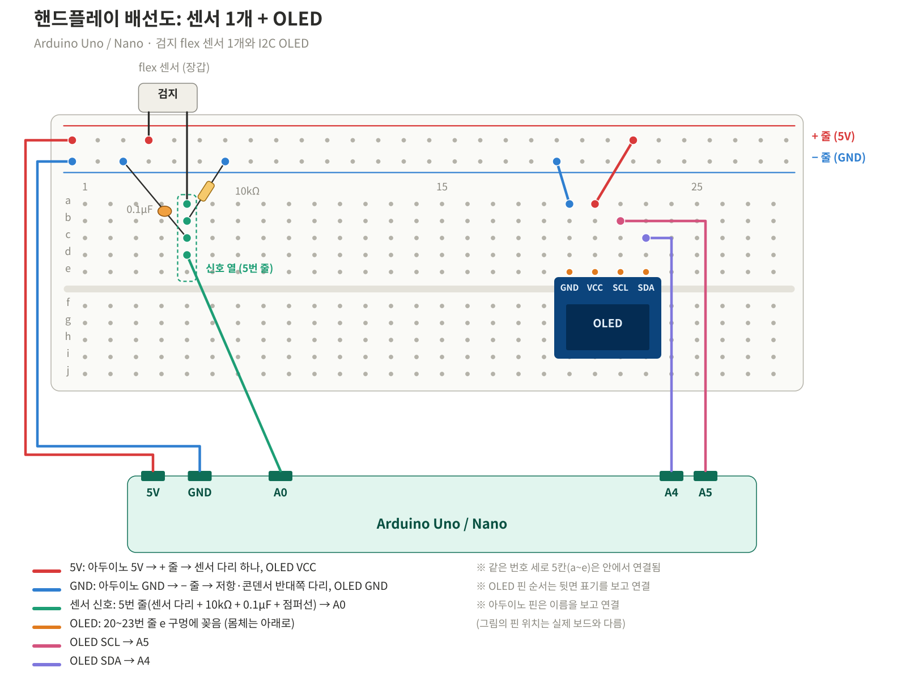
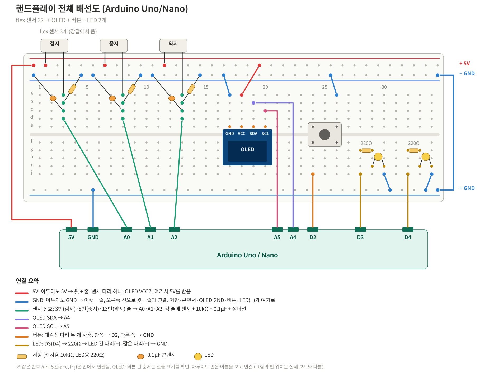

# 배선도 (Arduino Uno/Nano 버전)

flex 센서 3개(검지·중지·약지) + OLED + 버튼 + LED 2개. 원본 설계서(ESP32, 센서 5개)와 다른 버전이다.

## 1단계: 센서 1개 + OLED (현재 조립 상태)

## 최종: 센서 3개 + OLED + 버튼 + LED

## 연결표

| 부품 | 연결 | 아두이노 핀 |
|---|---|---|
| 전원 | 5V → + 줄, GND → − 줄 | 5V, GND |
| flex 센서 ① 검지 | 한쪽 다리 → + 줄, 다른 쪽 → 신호 열 | 신호 열 → A0 |
| flex 센서 ② 중지 | 같은 방식 | A1 |
| flex 센서 ③ 약지 | 같은 방식 | A2 |
| 10kΩ ×3 | 각 신호 열 ↔ − 줄 | - |
| 0.1µF ×3 | 각 신호 열 ↔ − 줄 | - |
| OLED (I2C 4핀) | GND → − 줄, VCC → + 줄 (3.3V 전용 모듈이면 3.3V 핀) | SDA → A4, SCL → A5 |
| 버튼 | 대각선 다리 두 개: 한쪽 → D2, 다른 쪽 → − 줄 | D2 (내부 풀업) |
| LED ×2 | D3(D4) → 220Ω → LED 긴 다리(+), 짧은 다리(−) → − 줄 | D3, D4 |

## 신호 열

센서 하나당 브레드보드 세로 5칸 묶음(a~e) 하나를 쓴다. 이 묶음에 아래 4개를 함께 꽂는다.

1. flex 센서 다리
2. 10kΩ 저항 한쪽 다리 (반대쪽 → − 줄)
3. 0.1µF 콘덴서 한쪽 다리 (반대쪽 → − 줄)
4. 아날로그 핀(A0/A1/A2)으로 가는 점퍼선

## 주의

- OLED·버튼 핀 순서는 제품마다 다르므로 실물 표기를 보고 연결한다.
- + 줄이 가운데에서 끊긴 브레드보드는 끊긴 곳을 점퍼선으로 잇는다.
- 그림의 아두이노 핀 위치는 실제 보드와 다르다. 핀 이름을 보고 연결한다.
- ESP32로 바꾸면 + 줄은 반드시 3.3V로 한다 (ESP32 입력 핀에 5V 금지).
